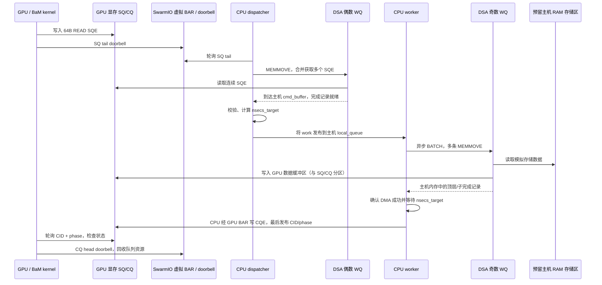

# BaM → SwarmIO：当前 DSA 版本的完整 I/O 流程

基于本地代码阅读：SwarmIO `dda701f`，BaM 子模块 `bd91415`。本文以 `bam-dsa-scale-lab230.json` 的执行方式为主：DSA 合并获取 SQE、异步 BATCH 搬运 payload、CPU 写 CQE，4 个 service unit、每单元 1 个 dispatcher + 1 个 worker。运行参数以各次构建 manifest 和 run.json 为准。

本地 `results/20261106-155216-775574/run.json`（相对工作区根目录）确认了 `sq_backend=dsa-coalesced`、`payload_backend=dsa-borrowed-batch`、batch128/depth16，以及 67,108,864 条真实 READ 对应同样数量的 payload 完成和 SQ entries。这里只阅读代码与已有结果，没有重新运行服务器实验。

## 1. 总体结构



GPU 直接生成 NVMe 命令。SwarmIO CPU 线程实现控制器接收、时延建模与完成逻辑；DSA 执行实际内存搬运。模拟存储后端为预留主机 RAM，没有向物理 NVMe SSD 继续下发请求。

## 2. 运行前：建立控制器、队列与地址映射

### 2.1 SwarmIO 初始化

`src/main.c::__load_configs()` 划分预留内存：

- `cmd_buffer_start = memmap_start + 1 MiB`：保存从 GPU 取回的命令。
- `storage_start = memmap_start + 4 GiB`：模拟 namespace 的实际数据区。
- `storage_size = memmap_size - 4 GiB`。例如 4G 起始、24G 预留时，数据区物理起点为 8GiB，可用模拟存储为 20GiB。

`nvmev/pci.c::__init_nvme_ctrl_regs()` 映射虚拟控制器 BAR；`vdev->dbs` 从 BAR 偏移 0x1000 开始。每个 QID 使用两个 32 位门铃：`dbs[2*qid]` 是 SQ tail，`dbs[2*qid+1]` 是 CQ head。

DSA 初始化通过 DMAengine 借用已经启用的 dedicated/kernel WQ，随后通过 IDXD 分配、提交描述符；不会在加载时重新配置设备。当前地址路径要求 IOMMU 关闭且没有 kernel PASID。

### 2.2 BaM 打开控制器并建立 QP

`benchmarks/bam_dsa_read.cu::main()` 创建 `Controller("/dev/libnvm0", 1, gpu, queue_depth, num_queues)`。

`bam/include/ctrl.h::Controller()` 完成控制器 BAR 映射、admin queue 初始化、namespace 查询、队列数量协商，并通过 `cudaHostRegisterIoMemory` 让 GPU 能访问 doorbell。映射长度随请求 QP 数量计算，覆盖高 QID 的门铃。

`bam/include/queue.h::QueuePair()` 在 GPU 上分配 SQ 和 CQ，通过 admin 命令先建 CQ、再建 SQ。SQE 是 64B，CQE 是 16B。QP 的 NVMe QID 从 1 开始。

SwarmIO 在 `nvmev/admin.c::admin_create_sq()/admin_create_cq()` 中接收建队列命令：

- SQ 保存 GPU 队列的 `cmd->prp1` 到 `sq->dma_addr`，并为它建立 CPU I/O 映射。
- SQ 另有位于预留主机 RAM 的 `cmd_buffer` 和对应 `cmd_buffer_dma`。
- CQ 建立 CPU 可写的 GPU BAR 映射，初始化 tail/head/phase。

CPU 的 GPU 队列映射与 DSA 的 DMA 地址是两种访问视图；DSA SQ 获取使用 `sq->dma_addr`，并非 CPU 虚拟地址。

### 2.3 GPU 缓冲区 pin 与 PRP

`page_cache_t` 创建 GPU 数据缓冲区及 PRP 表。`bam/module/map.c::map_gpu_memory()` 使用 NVIDIA persistent P2P pin，再执行 `nvidia_p2p_dma_map_pages()`；将返回的 `mapping->dma_addresses[]` 作为 I/O 地址。

DSA 配置加载 `libnvm` 时设置 `dma_peer_bdf` 为 DSA PCI 地址，因此这里取得的是供 DSA peer 使用的 GPU DMA 地址。PRP、SQ 建队列地址都不能理解为普通 CUDA 虚拟指针。

pin 的 NVIDIA 粒度为 64KiB；NVMe 控制器页和当前 worker 单段约束按 4KiB 处理；512B/4KiB benchmark 请求又是另一层粒度。

## 3. GPU 生成一条 READ

当前 DSA 入口为 `benchmarks/bam_dsa_read.cu::read_kernel()`。`scripts/swarmio_bam.py` 在 DSA 构建中用 `SWARMIO_BENCH_SOURCE` 指向这个文件。

每个线程：

1. 按 `tid % n_qps` 选择 QP；其 NVMe QID 为数组下标加 1。
2. 计算本次随机或顺序 page。READ 的起始 LBA 为 `page * blocks`，`blocks = page_size / ctrl.blk_size`。
3. `get_cid()` 分配该 SQ 上未占用的 16 位 CID。
4. `nvm_cmd_header()` 写 READ opcode、CID、NSID。
5. `nvm_cmd_data_ptr()` 写 `pc->prp1[tid]` 及必要的 PRP2；每线程独占自己的数据槽。
6. `nvm_cmd_rw_blks()` 写 SLBA 和块数，`sq_enqueue()` 提交。
7. 等待当前 CID 完成，处理 CQ 后归还 CID，才进入下一次循环。

因此一个 GPU 线程同时最多维护一条这样的请求，整个 GPU 通过大量线程和 QP 并发提供请求。`reqs` 是每线程重复次数，不是每线程并行深度。

**与原 BaM page cache 路径的区别：** `bam/include/page_cache.h::read_data()` 使用相同的底层命令/队列接口，但在首次完成后还调用 `enqueue_second()`，其协调路径可能发出额外的单块 READ。当前 DSA benchmark 直接构造命令，绕过 page cache 命中/替换和这个额外读路径，确保每次逻辑操作恰好对应一条 NVMe READ；`page_cache_t` 在此主要提供数据缓冲与 PRP。

## 4. BaM 如何发布 SQE 和门铃

`bam/include/nvm_parallel_queue.h::sq_enqueue()`：

1. 用 `in_ticket.fetch_add()` 领取逻辑序号，以队列 mask 确定环槽，以 ticket 代数等待该槽可复用。
2. 将 64B 命令复制到 GPU SQ 的相应槽。
3. 执行 `__threadfence_system()`，然后设置该槽的 `tail_mark`。
4. 竞争 `tail_lock`；持锁线程通过 `move_tail()` 合并已经连续就绪、且不会追上 head 的槽。
5. 使用 `st.mmio.relaxed.sys.global.u32` 写 SQ tail doorbell，然后推进软件 tail。

因此门铃更新可以覆盖多个 GPU 线程提交的 SQE；并非每个逻辑请求必然单独敲一次门铃。运行热路径无需 CPU 逐请求代 GPU 提交，也没有逐请求系统调用。

## 5. SwarmIO 接收并获取 SQE

`src/dispatcher.c::swarmio_dispatcher_thread_fn()` 循环处理 BAR、admin 与 I/O 队列。`swarmio_proc_submission_queues()` 扫描自己拥有的 QID，比较 `new_db = dbs[2*qid]` 与 `old_dbs[2*qid]`；不同则调用 `swarmio_dispatch_sq()`。

在当前 COALESCE=y、DMA_DISPATCHER=y、PREFETCH=n 配置中：

1. 根据门铃与 `sq->fetched_pos` 算出尚未获取的连续 SQE 数量。
2. 跨环尾时先处理环尾段；每次最多 `NR_MAX_FETCH_SQE` 条。
3. 调用 `dsa_dma_issue_sync_single()`，提交一条 `DSA_OPCODE_MEMMOVE`：

   ```text
   src = sq->dma_addr       + fetched_pos * 64   （GPU SQ）
   dst = sq->cmd_buffer_dma + fetched_pos * 64   （主机 RAM）
   len = num_fetch * 64
   ```

4. `idxd_submit_desc()` 后 CPU 轮询该描述符的完成记录；确认成功并执行读屏障后才解析命令。
5. 检查 SQE，调用批量时延模型，为每个命令计算 `nsecs_target`，然后推进 `fetched_pos`。

这里的“批量”是一条 MEMMOVE 搬多个 SQE，不是硬件 BATCH。当前未开启 SQ 预取，dispatcher 会等待本次 SQ DMA 完成才继续；配置两个 fetch 描述符并不代表已经实现同一 dispatcher 的双缓冲预取。

`fetched_pos` 是已经搬到主机的位置；`old_dbs` 是已经成功分派的位置；`sq_head` 是控制器已经消费的位置。主机缓存中的命令尚未全部入 worker 队列时，它们可以不同。

## 6. 时延建模、分派及服务单元归属

`simple_sched_nvme_cmd_aggregated()` 为本次取回命令累计各模拟调度实例的服务时间，通过 CAS 预留实例时间，再依次生成各请求的目标完成时间。它不等待真实 SSD，也不推迟到目标时刻才搬数据；worker 在发布完成时检查目标时间。

当前配置为 8 个模拟调度实例、512B 调度单元、read_sched_delay=400ns、read_min_delay=49,600ns。无排队的单个 512B READ 模型目标约为模型起点后 50µs；实际完成还受软件排队、DMA 和 CQ 发布影响。

`__dispatch_sq_entry()`：

- 选择负责该 QID 的 worker，检查其主机 `local_queue` 是否有空槽。
- 将 `cmd_buffer` 中的 SQE 再复制一份到 `swarmio_io_work.cmd`；保留 CID、SQID、CQID、target time。
- 初始化 `is_issued/is_copied/is_completed=false`。
- 推进 `sq_head`，以 release store 发布 local_queue tail；worker 用 acquire load 读取。

当前关闭连续 QID 分配和 worker RR：4 个 dispatcher 交错拥有 QID，分别为 1/5/9…、2/6/10…、3/7/11…、4/8/12…。每个单元一个 worker，因而 QP/CQ 具有固定的处理者。

| Service unit | SQ fetch WQ | Payload WQ | CPU（8–15配置） |
|---|---|---|---|
| 0 | dsa0 WQ0 | dsa0 WQ1 | dispatcher 8 / worker 9 |
| 1 | dsa0 WQ2 | dsa0 WQ3 | dispatcher 10 / worker 11 |
| 2 | dsa0 WQ4 | dsa0 WQ5 | dispatcher 12 / worker 13 |
| 3 | dsa0 WQ6 | dsa0 WQ7 | dispatcher 14 / worker 15 |

分配公式见 `dsa_assign_wq_by_group_disagg()`：`group = service_unit_id % groups`，dispatcher 使用偶数 WQ，worker 使用奇数 WQ。更多 service unit 可以共享组内 WQ，但各自保持独立描述符和回调上下文，并核对总额度。

## 7. Worker 将请求变成异步 DSA BATCH

`src/worker.c::swarmio_proc_io()` 每轮先 poll 已有 batch 完成、检查尾批 flush，再扫描软件请求队列。

`__swarmio_xfer_data_using_dma()` 解析 NVMe 长度与 PRP：

```text
storage_offset = SLBA << 9
length         = (NLB + 1) << 9
READ:  storage_start + storage_offset → PRP GPU DMA address
WRITE: PRP GPU DMA address → storage_start + storage_offset
```

当前 batch profile 在入队前要求整条请求位于一个 4KiB 物理页内；512B/4KiB 是已支持的基准几何。虽有通用 PRP 解析代码，这条异步入口会先拒绝跨页请求，避免部分提交后重试造成重复搬运。DSA benchmark 当前只产生 READ。

调用链为：

```text
swarmio_proc_io
  → __swarmio_xfer_data_using_dma
    → __swarmio_submit_dma
      → __dsa_dma_issue
        → dsa_dma_batch_enqueue
```

`dsa/batch.c::dsa_dma_batch_enqueue()` 为请求填充一个二级 MEMMOVE 描述符，同时保存对应的 `swarmio_io_work*`；描述符与 DSA 完成记录位于主机内存。凑满 batch128 自动 flush；不足一批时从第一条入批起计时，由 worker 轮询检查 5µs flush 阈值。阈值不是硬实时保证；单条尾批补 NOOP 以满足硬件 BATCH 至少两条子描述符的约束。

`flush()` 构造顶层 `DSA_OPCODE_BATCH`，指向二级描述符列表，执行 `dma_wmb()` 后 `idxd_submit_desc()`。worker 不逐批阻塞，继续提交或处理完成。每 worker depth16 表示有 16 个顶层 batch 槽；batch128 × depth16 对应最多 2048 条 payload 子描述符容量，4 worker 合计 8192 条。它既不是 QP 数，也不是 NVMe QD，更不直接表示硬件同时执行的请求数。

## 8. DMA 完成与 NVMe 完成是两个阶段

`dsa_dma_batch_poll()` 扫描顶层完成记录；观察到完成后执行 `dma_rmb()`，检查顶层和全部有效子描述符状态，更新真实完成数和字节数，再对每条请求调用 `__swarmio_batch_cb()`。

回调只设置 `is_copied=true`，或设置失败状态，不直接写 NVMe CQE。拥有该请求的 worker 在第二轮扫描里调用 `__swarmio_complete()`，仅在当前时间达到 `nsecs_target` 后尝试发布 CQE。

成功 NVMe 完成的条件为：实际数据搬运成功、模型目标时间已到、CQ 有可用槽。DMA 先完成就等待模型；模型先到期仍需等待 DMA。local_queue 仅回收从 head 开始连续完成的 work，避免覆盖仍被 DMA 回调引用的请求。

当前 `CONFIG_SWARMIO_COMMIT=n`，所以没有独立 committer 线程参与这条路径。

## 9. CPU 发布 CQE，GPU 回收资源

`src/worker.c::__fill_cq_result()` 读取 CQ head doorbell 判断空间，将当前 `sq_head` 写入 CQE 的 SQHD，附带 SQID、CID、状态与 phase。

对于 GPU BAR，先 `writel()` 写 dword2（SQHD/SQID），执行 `wmb()`，最后 `writel()` 写 dword3（CID/status/phase）。当前常规 READ 完成路径实际发布关键的末尾两个 dword，不是对 GPU CQ 做一次普通 16B memcpy。phase 随 CQ 绕环翻转。

BaM 的 `cq_poll()` 通过 volatile 读取 dword3，寻找 CID 与预期 phase；基准检查非零错误状态。`cq_dequeue()` 标记该完成已消费，合并连续 CQ head，通过 CQE 中的 SQHD 推进 SQ head 并释放 SQ ticket，再写 CQ head doorbell，最后 `put_cid()` 归还 CID。该线程随后才能复用自己的数据槽发下一次请求。

BaM 创建的 CQ 禁用每队列中断；GPU 在这里主动轮询完成。worker 仍有中断扫描代码，但这条 BaM 完成路径不依赖中断通知 GPU。

## 10. 背压与失败处理

- **GPU SQ 无空槽：** ticket/队列空间约束让提交者等待。
- **worker local_queue 满：** dispatcher 停止本次分派，不越过尚未消费的命令；后续重试。
- **payload batch 槽满：** `dsa_dma_batch_enqueue()` 返回 `-EAGAIN`；包装层原样上传，worker 恢复 `is_issued=false`，后续重试，不生成失败 CQE。这是 `ebe09a0` 修正的高压问题。
- **CQ 满：** `__fill_cq_result()` 返回 false，保留 work，等待 GPU 推进 CQ head。
- **SQ DMA 失败：** 锁存故障，停止分派，不推进失败批的 fetched_pos，不回退 CPU。
- **payload DSA 故障：** 不回退 CPU。BATCH 失败执行 DRAIN；超时只锁存故障，不提前复用或释放仍可能被硬件访问的资源。错误 CQE 发布前需要跨 worker 的提交/排空屏障，避免 GPU trap 后仍有 DMA 写入。

## 11. 如何解读吞吐和两层“批量”

单条 512B READ，至少涉及 64B GPU SQE 读取、512B RAM→GPU payload 搬运，以及 CPU 发布 CQE 的关键 dword 写入。12M IOPS 对应约 6.144GB/s 有效载荷，另有约 0.768GB/s SQE 内容；尚未计入门铃、DSA 描述符/完成记录和 PCIe 协议开销。

SQ 合并条数由各 QP 当前可见的连续就绪命令和环边界决定；payload batch 大小由 worker 的入批/flush 决定，两者独立，不能都当作固定 128。

上述已有运行记录中，平均 payload batch 为约 127.82 条，平均 SQE/DMA 为约 73.43 条，正好说明它们不相等。batch 峰值64是加载以来软件未回收批次槽峰值，不是硬件执行深度。

代码入口索引：`benchmarks/bam_dsa_read.cu`、`bam/include/{ctrl.h,queue.h,page_cache.h,nvm_parallel_queue.h}`、`bam/module/map.c`、`nvmev/{pci.c,admin.c}`、`src/{dispatcher.c,worker.c,simple_timing_model.c}`、`dsa/{dsa.c,single.c,batch.c}`。
